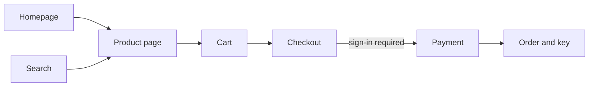

# Eneba Intern Assignment 2027

You have to complete this homework assignment within 7 days after getting the assignment. Please reply to the registration email with your results as described below.

## Requirements of the assignment

- AI and agentic coding is strongly encouraged. Ask your agent to save a log of your conversations (full) which are required to submit. In case you use a non-agentic approach, please provide a link to the conversation.
- We want to understand how you use AI.
- You must be able to explain your code.
- Shortcuts are allowed, specs are intentionally vague and open for interpretation. You decide the scope and you will have to justify it.
- Please implement a marketplace web application in Eneba's style that matches eneba.com website, with the following parts:
  - **Store**: A catalog where visitors can browse every product in the marketplace. They can narrow the list with filters (for example platform, region or price), change the order, and search by name.
  - **Homepage**: The landing page is assembled from several different blocks, such as a banner, best sellers or deals. Each block gets its content from its own backend service or database, so the frontend only displays what it receives and nothing is hardcoded there.
  - **Search**: Visitors can search for products by name from anywhere in the app and see the matching results. Search should cope with typos and partial names where it can.
  - **Product page**: The page for a single product, showing its details and the offers from several sellers, so a buyer can compare and choose.
  - **Checkout**: A buyer can put products in a cart, pay, and receive the digital key they bought. Payment can be simulated or use a payment provider's test mode. No real money is involved.
  - **Authentication**: Visitors can create an account and sign in. Some parts of the app, such as checkout and order history, are only for signed-in users.
  - **Eneba styling**: The app should look and feel like Eneba. Colors, typography, spacing and components follow the design reference.

## Purchase flow (from the assignment diagram)

A purchase starts from the homepage or from search.

- Entry points: Homepage and Search
- Checkout requires sign-in
- Eneba styling applies to every screen

## Technical requirements

- React for frontend (TypeScript preferred)
- Backend in PHP (or Go), REST or GraphQL
- Any database, decide on the data you need yourself
- Architecture, data model and scope are yours to decide. A few features done extensively beat many fitting minimal requirements.

## Deliverables (no evaluation without the following)

- GitHub link(s) to the project
- Public URL where the app is deployed on a free-tier service (for example Render or Vercel)
- Agent chat history (full, both prompts and responses) in a md file or a link to AI chat
